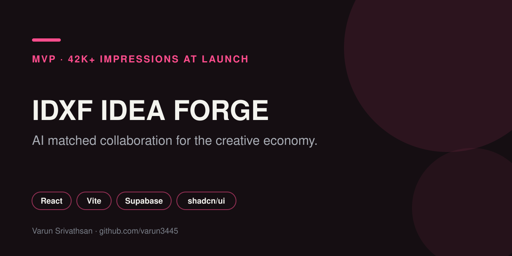

# IDXF: Idea Forge (MVP)

A collaboration platform for the creative economy. Creatives lose hours every week across disconnected tools and have no structured way to find collaborators. Idea Forge brings profiles, project matching, community and messaging into one place.

I founded the product and led design for a team of 10 core contributors from concept to MVP. At launch it reached **42K+ impressions in the first 48 hours**.

Live: [idxf.netlify.app](https://idxf.netlify.app)

    

## What is in it

| Area | Pages |
| --- | --- |
| Discover | Explore, Forge, Matches |
| Projects | Projects, Project detail, Join project |
| People | Profile, Communities, Chat |
| Experiments | Experiment Lab |
| Account | Login, Signup |

AI features run as Supabase edge functions: `search-with-ai` and `project-ai-assistant`.

## Stack

React 18, Vite, TypeScript, Tailwind CSS, shadcn/ui on Radix primitives, TanStack Query, React Router, Framer Motion, Recharts, Zod, Supabase (auth, Postgres, edge functions).

## Related

- [`IDXF_Final-public_RCA`](https://github.com/varun3445/IDXF_Final-public_RCA): the full stack build submitted at the Royal College of Art.
- Case study: [varunsrivathsan.com](https://varunsrivathsan.com)

## Author

[Varun Srivathsan](https://varunsrivathsan.com).
